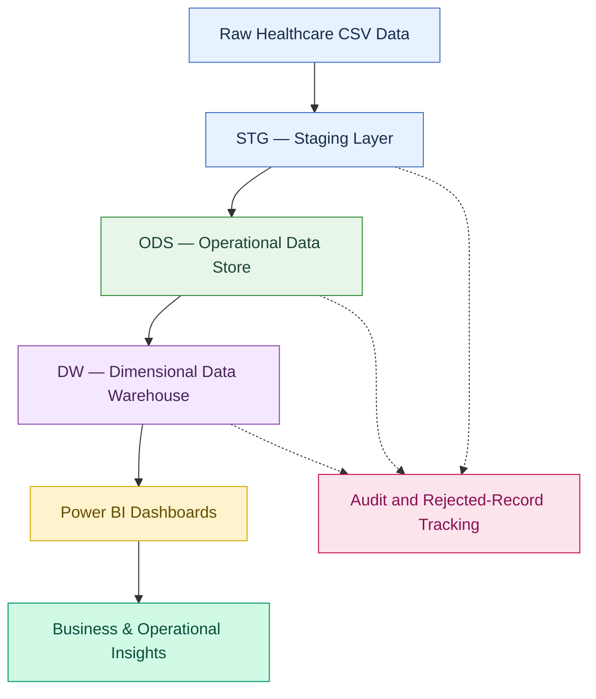

# MediCore | End-to-End Healthcare Data Engineering & Business Intelligence

**From raw healthcare data to a dimensional data warehouse and interactive Power BI dashboards.**

<p align="center">
  
  
  
  
</p>

## 1. Executive Summary

MediCore is an end-to-end healthcare data analytics and data engineering project built to demonstrate how raw operational healthcare data can be transformed into a structured data warehouse and converted into actionable business intelligence.

Healthcare organizations generate interconnected data across patients, appointments, doctors, departments, laboratory investigations, prescriptions, insurance policies, billing, and payments. Analyzing these records independently can make it difficult to establish consistent metrics, maintain data quality, and evaluate operational and financial performance.

MediCore addresses this challenge through a layered SQL Server data architecture, followed by an analytical warehouse and interactive Power BI dashboards.

The project combines data ingestion, relational normalization, data quality handling, ETL auditing, dimensional modeling, historical patient tracking, and business-facing visual analytics.

**The objective is to bridge the gap between data engineering and business decision-making.**

## 2. Solution Architecture

The project follows a multi-layer data processing workflow.



### Layer 1 — Staging (`stg`)

The staging layer serves as the initial landing zone for raw healthcare records.

Key responsibilities:

- Define a staging table for source data.
- Ingest CSV data using SQL Server `BULK INSERT`.
- Preserve source values before downstream transformations.
- Provide a consistent input structure for subsequent ETL processes.

### Layer 2 — Operational Data Store (`ods`)

The ODS transforms raw records into structured relational entities.

Key responsibilities:

- Normalize patient, doctor, department, branch, and insurer information.
- Separate multi-valued patient allergies and insurance policies into dedicated tables.
- Convert source values into appropriate SQL Server data types.
- Standardize text and categorical values.
- Handle duplicate patient and appointment records using `ROW_NUMBER()`.
- Apply primary keys, foreign keys, unique constraints, and check constraints.
- Log rejected records and track ETL load execution.

### Layer 3 — Data Warehouse (`dw`)

The warehouse organizes operational records into analytical dimensions and fact tables.

Key responsibilities:

- Build a star-schema-oriented dimensional model.
- Generate surrogate keys for dimensional relationships.
- Create a date dimension with calendar and fiscal attributes.
- Implement Slowly Changing Dimension (SCD) Type 1 and Type 2 logic.
- Load appointment, billing, laboratory, and prescription facts.
- Use unknown dimension members to handle unresolved dimension references.

### Layer 4 — Business Intelligence

The Power BI report provides a business-facing analytical layer on top of the data warehouse.

It includes dedicated pages for executive revenue analysis, revenue details, and clinical operations. These views help explore financial performance, billing quality, appointment activity, laboratory results, and prescription patterns.

## 3. Power BI Dashboard Suite

The Power BI report, `medicore-dashboard.pbix`, contains three analytical report pages.

### 3.1 Executive Revenue

The executive revenue page focuses on financial performance and billing quality.

Key analytical areas include:

- Revenue trends and fiscal-year comparisons.
- Verified versus unverified revenue.
- Billing defect percentage.
- Absolute financial exposure associated with billing defects.
- Department-level revenue comparisons.
- Revenue analysis across reporting periods.

**Business questions addressed:**

- How does reported revenue change over time?
- How much revenue is classified as verified versus unverified?
- Which departments contribute most to reported revenue?
- What is the financial exposure associated with identified billing defects?

### 3.2 Revenue Details

The revenue details page provides a more granular view of billing performance.

Key analytical areas include:

- Reported revenue.
- GST collected.
- Average bill value.
- Bill counts.
- Billing validity.
- Department-level revenue analysis.

**Business questions addressed:**

- How does average bill value vary across the business?
- How much GST is recorded in the billing data?
- How do billing records and financial totals vary by department?
- What proportion of bills meets the defined validity criteria?

### 3.3 Clinical Operations

The clinical operations page focuses on healthcare delivery and clinical activity.

Key analytical areas include:

- Appointment volumes.
- Appointment completion rate.
- No-show rate.
- Abnormal laboratory results.
- Doctor-level activity.
- Medicine analysis.

**Business questions addressed:**

- How effectively are scheduled appointments being completed?
- What proportion of appointments are recorded as no-shows?
- How does activity vary across doctors?
- What patterns can be explored in laboratory results and prescription data?

*The descriptions above summarize the report's analytical areas. Actual KPI values, business-rule definitions, and conclusions should be interpreted from the underlying report and data.*

## 4. SQL Data Engineering Implementation

The project demonstrates a range of SQL Server techniques used to build and maintain an analytical data platform.

### Data ingestion and transformation

- `BULK INSERT` for CSV ingestion.
- `TRY_CAST` and `TRY_CONVERT` for type-safe transformation.
- `LTRIM`, `RTRIM`, `NULLIF`, and `CASE` for data standardization.
- `STRING_SPLIT` with `CROSS APPLY` for handling multi-valued allergy attributes.
- Common Table Expressions (CTEs) for structured transformations.
- `ROW_NUMBER()` for deduplication and record selection.

### Data quality and integrity

- Primary and foreign key constraints.
- Unique and check constraints.
- Duplicate detection and handling.
- Invalid-value and null handling.
- Rejected-record logging.
- Referential integrity across related healthcare entities.

### ETL auditing

The pipeline uses an audit layer to track data loading activity.

Implemented patterns include:

- Load-control records with load identifiers.
- Source-system and load-name tracking.
- Inserted and rejected row counts.
- Rejected-record logging for staging-to-ODS processing.
- Transactional error handling in the staging-to-ODS workflow.

### Database design

The operational layer applies normalization principles to reduce redundancy and represent healthcare relationships more clearly.

Examples include separating patient allergies from patient records, separating insurer details from patient insurance policies, and maintaining doctor information independently from individual appointments.

## 5. Dimensional Modeling & Data Warehouse Design

The warehouse uses fact and dimension tables to make analytical queries more straightforward.

### Fact tables

| Fact table | Analytical purpose |
|---|---|
| `dw.FactAppointment` | Appointment activity and related measures |
| `dw.FactBilling` | Billing amounts, discounts, taxes, and payment analysis |
| `dw.FactLabResult` | Laboratory activity, results, and charges |
| `dw.FactPrescription` | Prescription activity, medicines, and associated charges |

### Dimension tables

| Dimension | Analytical purpose |
|---|---|
| `dw.DimDate` | Calendar and fiscal reporting |
| `dw.DimPatient` | Patient attributes and historical versions |
| `dw.DimDoctor` | Doctor-level analysis |
| `dw.DimDepartment` | Department-level analysis |
| `dw.DimBranch` | Branch-level analysis |
| `dw.DimInsurer` | Insurance and self-pay analysis |
| `dw.DimLabTest` | Laboratory test analysis |
| `dw.DimMedicine` | Medicine and prescription analysis |
| `dw.DimPaymentMode` | Payment mode and payment status analysis |

### Surrogate keys and unknown members

Warehouse dimensions use surrogate keys to establish analytical relationships independently of source-system identifiers.

The loading script also creates reserved unknown members for selected dimensions. These allow certain fact records to reference an explicit unknown dimension record when the corresponding entity is unavailable.

### Slowly Changing Dimensions

The project implements two dimension-update strategies.

**SCD Type 1 — Overwrite**

Selected dimensions, including doctor and department dimensions, are updated when source attributes change. Previous values are not retained as historical versions.

**SCD Type 2 — Historical tracking**

The patient dimension uses historical versioning logic to preserve changes to tracked attributes. Effective-date fields and a current-record indicator distinguish historical versions from the current version.

This design supports analysis that needs to distinguish the current patient profile from prior versions.

## 6. Repository Structure

```text
end_to_end_de/
│
├── 01_CREATE TABLE QUERY.sql
├── 02_BULT INSERT.sql
├── 04_load_stg_to_ods.sql
├── 05_ods_normalised.sql
├── 07_loads_ODS_to_dw_star_schema.sql
├── medicore-dashboard.pbix
└── README.md
```

| File | Purpose |
|---|---|
| `01_CREATE TABLE QUERY.sql` | Creates staging-related schemas and the raw landing table; includes bulk-load setup |
| `02_BULT INSERT.sql` | Defines the CSV ingestion operation |
| `05_ods_normalised.sql` | Defines normalized operational data entities and constraints |
| `04_load_stg_to_ods.sql` | Transforms staging data into ODS entities and records load outcomes |
| `07_loads_ODS_to_dw_star_schema.sql` | Loads warehouse dimensions and analytical fact tables |
| `medicore-dashboard.pbix` | Power BI report containing the three analytical pages |
| `README.md` | Project documentation, architecture, and setup guidance |

**Note:** The SQL filenames are not strictly numbered in execution order. Review the dependencies within each script before running them.

## 7. Technology Stack

| Technology | Application |
|---|---|
| Microsoft SQL Server | Database engine |
| T-SQL | Data transformation, schema design, and ETL |
| SQL Server Management Studio (SSMS) | SQL development and execution |
| CSV | Raw data ingestion |
| Power BI | Interactive business intelligence and reporting |
| Git | Version control |
| GitHub | Source code hosting and project documentation |

## 8. Setup and Execution

### Prerequisites

- Microsoft SQL Server.
- SQL Server Management Studio or a compatible SQL client.
- Power BI Desktop to open the `.pbix` report.
- The source CSV file required by the ingestion script.
- Appropriate database permissions for schema creation, table creation, and bulk loading.

### Step 1 — Prepare the database

The SQL scripts reference a database named `MediCoreDW`.

Create the database and ensure the required `stg`, `ods`, `dw`, and `audit` schemas and prerequisite tables are available.

### Step 2 — Configure the source file

The ingestion scripts use a local Windows file path:

```text
C:\MediCore\hospital_raw.csv
```

Update the path to match the location of your CSV file. Ensure that the source column order and formats are consistent with the staging table definition.

SQL Server must be able to access the file using the permissions of the relevant execution context.

### Step 3 — Create the staging structure and ingest raw data

Execute the staging DDL and ingestion setup. Verify that the CSV loads into the expected staging structure.

### Step 4 — Create the ODS tables

Execute `05_ods_normalised.sql` to create the normalized ODS entities and their constraints.

Review the `DROP TABLE IF EXISTS` statements before running the script. They can delete existing tables and their data.

### Step 5 — Load staging data into the ODS

Execute `04_load_stg_to_ods.sql` after its prerequisite schemas and tables exist.

Review the load-control records and rejected-record logs to validate processing outcomes.

### Step 6 — Load the data warehouse

Execute `07_loads_ODS_to_dw_star_schema.sql` after the required warehouse table definitions are available.

Validate dimension and fact row counts and confirm that the relationships resolve as intended.

### Step 7 — Open the Power BI report

Open `medicore-dashboard.pbix` in Power BI Desktop.

Configure or refresh the data connection if required by your local environment. Confirm that the report is connected to the correct database and that its visuals reflect the expected warehouse data.

> **Important:** Review destructive table operations and the fact-table refresh strategy before rerunning the scripts against existing data. The warehouse-loading script truncates and reloads its fact tables, so repeated execution should be treated as a controlled rebuild rather than an incremental load.

## 9. Potential Business Applications

The warehouse and dashboard structure can support exploration of several healthcare management questions.

### Financial performance

- Revenue trends across reporting periods.
- Department-level revenue contribution.
- Billing validity and identified financial exposure.
- GST and average bill value analysis.

### Operational performance

- Appointment completion and no-show rates.
- Doctor-level activity comparisons.
- Appointment volume trends.
- Department and branch activity.

### Clinical activity

- Abnormal laboratory result patterns.
- Laboratory test activity.
- Medicine and prescription patterns.

### Data quality and governance

- Invalid and rejected source records.
- Duplicate records and referential integrity.
- Historical changes to patient attributes.
- Reconciliation between source records and warehouse outputs.

These are analytical use cases supported by the project's design; they are not claims of quantified business impact or verified findings.

## 10. Data Validation Checklist

Before using the dashboards for decision-making, validate:

- [ ] Source row counts against staging ingestion results.
- [ ] Invalid and unconvertible source values.
- [ ] Deduplication rules for patient and appointment records.
- [ ] Rejected-record counts and reasons.
- [ ] Foreign-key and dimension-key resolution.
- [ ] Fact-table totals against the corresponding source records.
- [ ] SCD Type 2 current-record and historical-version behavior.
- [ ] Revenue, GST, billing-validity, and financial-exposure definitions.
- [ ] Appointment completion and no-show definitions.
- [ ] Consistency between dashboard metrics and SQL validation queries.

## 11. Future Enhancements

Potential next steps include:

- Automated source-to-target reconciliation.
- Additional data-quality checks and exception reporting.
- Incremental ETL and change-data processing.
- Centralized configuration for environment-specific settings.
- Scheduled pipeline orchestration and monitoring.
- Expanded test coverage for SCD behavior and data integrity.
- More detailed technical documentation of fact-table grain and measures.
- Additional Power BI drill-through, tooltips, and analytical views.

These are proposed improvements, not features claimed to be implemented.

## 12. Data Privacy & Project Scope

MediCore is a portfolio project demonstrating SQL Server data engineering, dimensional modeling, and business intelligence concepts in a healthcare context.

It should not be interpreted as a production-certified healthcare information system. A production implementation would require appropriate security, privacy controls, access management, governance, testing, and operational monitoring.

Do not publish real patient identifiers, medical records, credentials, or confidential datasets in a public repository. Use synthetic or appropriately de-identified data for public demonstrations.

## 13. Author

**Vivaan Bagga**

GitHub: [@Vivaan2409](https://github.com/Vivaan2409)

Repository: [end_to_end_de](https://github.com/Vivaan2409/end_to_end_de)

---

*An end-to-end portfolio project exploring the intersection of data engineering, dimensional modeling, healthcare analytics, and business intelligence.*
