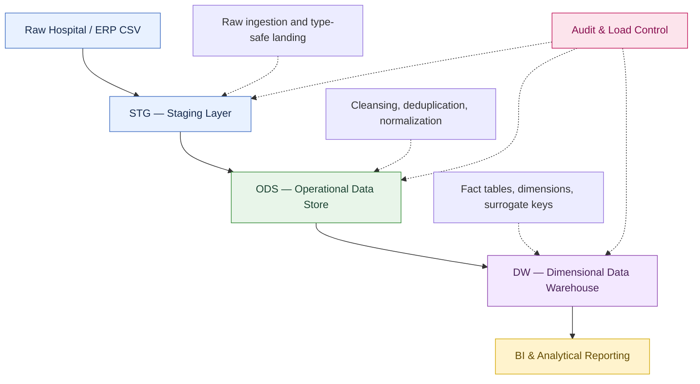

# MediCore — End-to-End Healthcare Data Warehouse

**An end-to-end SQL Server data engineering project transforming raw healthcare operational data into a structured, analytics-ready data warehouse.**

<p align="center">
  
  
  
  
</p>

## 1. Project Overview

MediCore is a healthcare data warehousing project designed to demonstrate how raw, operational hospital data can be transformed into a structured and analytics-ready format using Microsoft SQL Server and T-SQL.

Healthcare systems generate interconnected data across patients, doctors, departments, appointments, prescriptions, laboratory results, billing, payments, and insurance policies. Analyzing these entities directly from a denormalized source can introduce redundancy, inconsistent records, and complex analytical queries.

This project addresses those challenges through a layered data architecture that separates raw ingestion, operational data integration, and analytical reporting structures.

The pipeline incorporates data cleansing, type conversion, deduplication, relational normalization, referential integrity, ETL auditing, dimensional modeling, and historical patient tracking through Slowly Changing Dimensions.

**The objective:** demonstrate the design and implementation of a complete data warehouse workflow, from raw data ingestion to fact and dimension tables that can support downstream BI and business analysis.

## 2. Architecture

The solution follows a layered data warehousing architecture.



### Layer 1 — Staging (`stg`)

The staging layer acts as the raw landing zone for incoming hospital records.

Key responsibilities:

- Define a landing table for source data.
- Ingest CSV data using `BULK INSERT`.
- Preserve source values in flexible text columns before transformation.
- Support downstream cleansing and type conversion.

### Layer 2 — Operational Data Store (`ods`)

The ODS layer transforms the raw source into structured relational entities.

Key responsibilities:

- Normalize patient, doctor, department, branch, and insurer data.
- Separate patient allergies and insurance policies into dedicated entities.
- Convert source values into appropriate SQL Server data types.
- Standardize text fields and normalize selected categorical values.
- Deduplicate patient and appointment records using window functions.
- Enforce primary keys, foreign keys, unique constraints, and check constraints.
- Create indexes to support common appointment lookups.
- Track load execution and rejected records.

### Layer 3 — Dimensional Data Warehouse (`dw`)

The warehouse layer reorganizes operational data into analytical dimensions and facts.

Key responsibilities:

- Build a star-schema-oriented analytical model.
- Use surrogate keys to connect fact records to dimensions.
- Generate a date dimension with calendar and fiscal attributes.
- Implement Slowly Changing Dimension Type 1 for selected dimensions.
- Implement Slowly Changing Dimension Type 2 for patient history.
- Load appointment, billing, laboratory, and prescription facts.
- Introduce unknown dimension members to handle unresolved references.

### Audit Layer (`audit`)

The audit layer provides ETL execution metadata.

The loading scripts use a load-control table to identify pipeline stages and associate processing with a load ID. The staging-to-ODS workflow also includes a rejected-record logging mechanism.

## 3. Data Model

The project covers multiple healthcare entities and analytical processes.

### Operational entities

| Entity | Purpose |
|---|---|
| Patient | Patient demographic and contact information |
| Doctor | Doctor attributes and standard consultation fee |
| Department | Hospital department reference data |
| Branch | Hospital branch information |
| PatientAllergy | One record per patient-allergy combination |
| PatientPolicy | Patient insurance policies and coverage limits |
| Insurer | Insurance provider reference data |
| Appointment | Appointment details, status, and clinical information |
| LabResult | Laboratory test results and charges |
| Prescription | Prescribed medicines, dosage, and duration |
| Bill | Billing and payment information |

### Analytical fact tables

| Fact table | Analytical focus |
|---|---|
| `dw.FactAppointment` | Appointment activity and related measures |
| `dw.FactBilling` | Billing amounts, discounts, taxes, and payment-related analysis |
| `dw.FactLabResult` | Laboratory activity, results, and charges |
| `dw.FactPrescription` | Prescription activity, medicines, and associated charges |

### Key dimensions

The warehouse loading script uses dimensions including:

- `dw.DimDate`
- `dw.DimPatient`
- `dw.DimDoctor`
- `dw.DimDepartment`
- `dw.DimBranch`
- `dw.DimInsurer`
- `dw.DimLabTest`
- `dw.DimMedicine`
- `dw.DimPaymentMode`

The date dimension includes attributes such as calendar year, month, quarter, fiscal year, fiscal quarter, and weekend indicators.

## 4. Engineering Concepts Implemented

### Data ingestion and transformation

- `BULK INSERT` for CSV ingestion.
- `TRY_CAST` and `TRY_CONVERT` for safer type conversion.
- `LTRIM`, `RTRIM`, `NULLIF`, and `CASE` for data standardization.
- `STRING_SPLIT` with `CROSS APPLY` to transform multi-valued allergy fields.
- Common Table Expressions (CTEs) to structure complex transformations.

### Data quality and integrity

- Primary and foreign keys.
- Unique and check constraints.
- Duplicate handling through `ROW_NUMBER()`.
- Null and invalid-value handling.
- Rejected-record logging.
- Referential integrity between related healthcare entities.

### Relational database design

The ODS design demonstrates normalization principles:

- **First Normal Form (1NF):** patient allergies are separated from a multi-valued source field.
- **Second Normal Form (2NF):** doctor-level standard consultation fees are separated from individual appointment fees.
- **Third Normal Form (3NF):** insurer details and patient-policy attributes are stored separately.

These design choices reduce redundancy and establish clearer relationships between entities.

### Dimensional modeling

- Fact and dimension table design.
- Surrogate keys.
- Date dimension generation.
- Unknown dimension members using a reserved key.
- Star-schema-oriented analytical structures.
- SCD Type 1 and Type 2 dimension loading strategies.

### ETL control

- Load IDs to associate data with pipeline executions.
- Load-control records for ETL stages.
- Transactional loading in the staging-to-ODS workflow.
- Error and rejected-record handling mechanisms.

## 5. Slowly Changing Dimensions

An important feature of the warehouse is the use of two dimension-history strategies.

**SCD Type 1 — Overwrite**

Selected dimensions, including doctor and department dimensions, are updated when source attributes change. This maintains the latest attribute values without preserving prior versions.

**SCD Type 2 — Historical tracking**

The patient dimension uses historical versioning logic. When tracked patient attributes change, the warehouse can close the previous version and create a new current version.

The patient dimension includes fields such as:

- `PatientSK` — warehouse surrogate key.
- `EffectiveFrom` / `EffectiveTo` — version validity boundaries.
- `IsCurrent` — identifies the current version.

This supports analyses that require patient attributes to be interpreted according to their historical versions rather than only their latest values.

## 6. Repository Structure

The repository contains SQL scripts organized around individual warehouse implementation stages.

```text
end_to_end_de/
│
├── 01_CREATE TABLE QUERY.sql
├── 02_BULT INSERT.sql
├── 04_load_stg_to_ods.sql
├── 05_ods_normalised.sql
├── 07_loads_ODS_to_dw_star_schema.sql
│
└── README.md
```

| Script | Responsibility |
|---|---|
| `01_CREATE TABLE QUERY.sql` | Defines the raw staging table and related ingestion setup |
| `02_BULT INSERT.sql` | Defines the staging load view and bulk CSV ingestion |
| `05_ods_normalised.sql` | Creates normalized ODS entities and integrity constraints |
| `04_load_stg_to_ods.sql` | Transforms staging data into the ODS and handles load auditing |
| `07_loads_ODS_to_dw_star_schema.sql` | Loads warehouse dimensions and analytical fact tables |

The filenames above reflect the scripts included in this repository overview. Review the SQL dependencies and any additional scripts in the repository before executing the pipeline.

## 7. Technology Stack

| Technology | Role |
|---|---|
| Microsoft SQL Server | Database engine |
| T-SQL | Schema design, transformations, and ETL logic |
| SQL Server Management Studio (SSMS) | SQL development and execution |
| CSV | Source-data format |
| Git and GitHub | Version control and project documentation |
| Star schema | Analytical data modeling approach |

## 8. Setup and Execution

### Prerequisites

- Microsoft SQL Server.
- SQL Server Management Studio or another compatible SQL client.
- A source CSV compatible with the staging table structure.
- Permission to create schemas and tables, execute bulk loads, and access the required source file.

### Step 1 — Prepare the source file

The ingestion script references:

```text
C:\MediCore\hospital_raw.csv
```

Place your source CSV at that location or update the file path in the script to match your environment.

Ensure that the CSV column order and data format match the staging ingestion definition.

### Step 2 — Create the database and prerequisites

The scripts reference a database named `MediCoreDW`.

Create the database and verify that all required schemas, audit tables, dimension tables, and fact tables are defined before running the dependent loading scripts.

Some warehouse and audit table definitions may be maintained in additional SQL scripts. Execute those prerequisite definitions first.

### Step 3 — Create the staging structure

Execute the staging table definition and staging ingestion setup after checking the source file path and the dependencies between the scripts.

### Step 4 — Create the ODS structure

Run the ODS DDL script to create the normalized operational entities and their constraints.

Review the `DROP TABLE IF EXISTS` statements before execution: these are destructive rebuild operations and can remove existing tables and their data.

### Step 5 — Load staging data into the ODS

Execute the staging-to-ODS loading script after the staging table and ODS entities are ready.

Inspect the load-control records and rejected-record logs to validate the load.

### Step 6 — Load the dimensional warehouse

Execute the warehouse-loading script after the required dimension and fact table definitions are available.

Validate the fact-to-dimension relationships and confirm that the expected rows have been loaded.

> **Important:** The source scripts contain environment-specific assumptions, including a local CSV path and a SQL Server database name. Review and adapt these before running the pipeline. Execute the scripts in dependency order rather than relying solely on their filenames.

## 9. Potential Analytical Use Cases

The warehouse is structured to support questions such as:

**Appointment operations**
- How does appointment volume vary by date, department, doctor, or branch?
- What proportion of appointments are completed, cancelled, scheduled, or marked as no-shows?
- How do appointment trends vary across calendar and fiscal periods?

**Billing and payments**
- How do billing amounts, discounts, and taxes vary over time?
- Which branches or departments generate the highest billing totals?
- How do payment modes and payment statuses vary across transactions?

**Laboratory and prescriptions**
- Which laboratory tests occur most frequently?
- How do laboratory charges vary by test or time period?
- Which medicines are prescribed most often?
- How do prescription and laboratory charges contribute to overall activity?

**Patient and insurance analysis**
- How does patient activity change over time?
- How are appointments distributed across departments and branches?
- How do insurance providers and policy coverage limits vary across the patient population?

These are proposed analytical use cases enabled by the model, not claims of measured findings from a completed analysis.

## 10. Data Validation Checklist

Before treating the warehouse as reporting-ready, validate the following:

- [ ] Source row counts reconcile with staging ingestion results.
- [ ] Invalid or unconvertible source values are identified.
- [ ] Duplicate patient and appointment handling behaves as intended.
- [ ] Foreign-key relationships are satisfied.
- [ ] Rejected records are reviewed and accounted for.
- [ ] Fact records resolve to the appropriate dimension keys.
- [ ] SCD Type 2 processing maintains the intended current-record rules.
- [ ] Repeated pipeline executions do not create unintended duplicates.
- [ ] Billing totals reconcile with the source data.
- [ ] Date dimension coverage includes the required reporting periods.

## 11. Design Considerations and Future Improvements

Potential extensions include:

- Add automated reconciliation queries and data-quality reports.
- Introduce a centralized configuration for source paths and environment-specific settings.
- Add repeatable pipeline orchestration and scheduling.
- Expand ETL observability with row counts, execution status, and error details.
- Add incremental ingestion and change detection for larger source datasets.
- Create Power BI dashboards for operational and financial reporting.
- Add automated tests for referential integrity, duplicate detection, and SCD behavior.
- Document the grain, measures, and dimension relationships for every fact table.

These are possible extensions rather than features claimed to be already implemented.

## 12. Project Scope and Data Privacy

This repository demonstrates a technical data engineering workflow using healthcare-domain data structures. It is intended for learning, demonstration, and portfolio purposes.

The project does not claim to be a production-certified healthcare platform. Any real deployment
